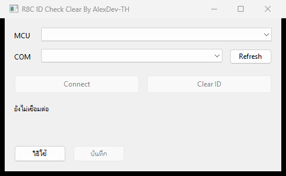

# R8C ID Check Clear By AlexDev-TH

โปรแกรม Windows native เขียนด้วย C++20 สำหรับเชื่อมต่อ UART ตรงเข้าชิป Renesas **R5F21548G (R8C/54G)** และ **R5F21347G (R8C/34G)** เพื่อขอคำสั่ง Forced Erase ตามมาตรฐานของชิป ไม่ใช้ .NET ไม่ใช้ FDT ไม่ใช้ DLL ของ FDT และไม่เรียกโปรแกรมภายนอกใด ขณะทำงาน

ใช้สำหรับงานซ่อมและกู้กล่องที่ติด ID Check เพราะแฟลชไฟล์ผิดรุ่นหรือรหัสหาย โดยเป็นงานบนฮาร์ดแวร์ของผู้ใช้เอง รุ่นนี้เป็นชุดเครื่องมือทางวิศวกรรม ผ่านการตรวจโค้ดและทดสอบโปรโตคอลแบบจำลองแล้ว ผู้ใช้ต้องยืนยันผลบนชิปจริงของตนเองก่อนเชื่อถือทุกครั้ง หน้าตาเป็น Windows common controls เรียบ รองรับ DPI scaling



> คำเตือน Clear ID คือการล้าง Program ROM และ Data Flash ทั้งหมด ไม่ใช่ลบเฉพาะรหัสแล้วเก็บโปรแกรมเดิมไว้ ถ้าต้องการเก็บโปรแกรมเดิม ต้องมีไฟล์สำรองที่ถูกต้องก่อนเริ่ม

## คุณสมบัติ

- เชื่อมต่อ standard serial I/O mode 2 ตรงผ่าน UART อ่าน boot version และสถานะ โดยไม่ส่ง ID หรือคำสั่งล้างในขั้นเชื่อมต่อ
- รองรับสอง MCU profile ที่ยืนยันขนาดและตำแหน่งหน่วยความจำแล้ว คือ R5F21548G และ R5F21347G
- ขอ Forced Erase เพียงครั้งเดียวต่อการกด แล้วตรวจ ID ค่า erased และอ่าน blank check ทั้งช่วงหน่วยความจำผู้ใช้
- แถบความคืบหน้าแบบจริง แสดงเปอร์เซ็นต์ จำนวนไบต์ ความเร็ว KB ต่อวินาที และเวลาที่เหลือโดยประมาณ
- ยืนยันก่อนล้างทุกครั้ง แสดงรุ่นและจำนวนไบต์ที่จะล้าง
- สร้าง session log ใน `logs/` โดยไม่บันทึกเนื้อหา ROM
- เป็นไฟล์เดียวจบ ไม่ต้องติดตั้ง ไม่มีระบบลงทะเบียนและไม่มี License Key

## การเตรียมฮาร์ดแวร์

1. ตรวจตัวอักษรบนตัวถังชิปแล้วเลือก MCU ให้ตรงรุ่น ห้ามเดารุ่นจาก boot version
2. ใช้สาย USB to UART และวงจรโปรแกรมที่ตรวจสอบระดับแรงดันแล้ว ให้ตรงกับชิป ห้ามต่อสัญญาณระดับ RS-232 เข้าชิปโดยตรง
3. ต่อ TX RX GND และไฟเลี้ยงตามวงจรที่ใช้งานได้จริง โปรแกรมตั้ง DTR และ RTS เป็น disabled ขาเหล่านี้ต้องไม่ถูกใช้คุม RESET หรือ MODE ในชุดทดสอบนี้
4. ตั้ง MODE และ RESET ด้วยมือให้ชิปเข้าสู่ standard serial I/O mode 2
5. ปิดโปรแกรมอื่นที่จองพอร์ต COM เดียวกันก่อนเริ่ม

## วิธีใช้งาน

1. เปิดโปรแกรม เลือก MCU ให้ตรงรุ่นบนชิป จากนั้นเลือกพอร์ต COM กด Refresh หากต้องการรายการพอร์ตล่าสุด
2. กด Connect โปรแกรมจะอ่าน boot version และสถานะเท่านั้น ไม่ส่ง ID และไม่ส่งคำสั่งล้าง และจะล็อก profile ที่เลือกไว้ตลอด session
3. เตรียมไฟล์เฟิร์มแวร์และวิธีเขียนกลับให้พร้อมก่อน จากนั้นกด Clear ID แล้วตอบยืนยันการล้าง คำเตือนจะแสดงรุ่นและจำนวนไบต์ที่จะล้าง
4. โปรแกรมขอ Forced Erase หนึ่งครั้ง ถ้าชิปยอมรับ จะตรวจค่า erased และอ่าน blank check ตาม profile จนครบ จึงแสดงผลสำเร็จและปล่อยพอร์ต COM
   - R5F21548G ช่วง `0x7000` ถึง `0x17FFF` รวม Program ROM 64 KiB และ Data Flash 4 KiB รวม 69,632 ไบต์ 272 หน้า
   - R5F21347G ช่วง `0x3000` ถึง `0xFFFF` รวม Program ROM 48 KiB และ Data Flash 4 KiB รวม 53,248 ไบต์ 208 หน้า
5. รีเซ็ตชิปกลับเข้าโหมดโปรแกรม แล้วใช้เครื่องโปรแกรมเดิมหรือ FDT เขียนเฟิร์มแวร์ที่ถูกต้องกลับเข้าไป ชิปที่ล้างแล้วยังไม่มีโปรแกรมสำหรับทำงาน ถ้าไฟล์ที่เขียนกลับมี ID ระบบ ID Check จะกลับมาตามไฟล์นั้น

หน้าต่างหลักขนาด 470 x 260 logical pixels มีช่องเลือก MCU และ COM ปุ่ม Refresh ปุ่ม Connect หรือ Disconnect ปุ่ม Clear ID แถบความคืบหน้า และสถานะย่อ รายละเอียดเพิ่มเติมเปิดได้จากปุ่มวิธีใช้และปุ่มบันทึก

## ข้อจำกัดที่ตรงกับตัวชิป

- เมื่อ ROMCP1 ต่อ ROMCR เป็น `01` และ ID ที่เก็บไว้ไม่ใช่ reserved forced-erase ID ชิปจะตรวจ ID ตามปกติและจะไม่ล้างโดยไม่รู้รหัส โปรแกรมนี้ไม่ข้ามข้อจำกัดดังกล่าว กล่องที่ล้างได้โดยไม่รู้รหัสคือกล่องที่ตั้ง protection ปิดอยู่แล้วเท่านั้น
- Reserved ID บางค่าที่ปิด standard serial interface อาจทำให้เชื่อมต่อไม่ได้
- Boot version เป็นข้อมูลของโปรแกรมบูต ไม่ใช่รหัสยืนยันรุ่นชิป ผู้ใช้ต้องเลือกรุ่นให้ตรงตัวอักษรบนชิป โปรแกรมรับรองเฉพาะสอง profile ข้างต้น
- Timeout, ID mismatch, ข้อมูลอ่านไม่ครบ, flash error หรืออ่านพบไบต์ที่ยังไม่ว่าง ไม่ถือว่าสำเร็จ โปรแกรมไม่ลองล้างซ้ำอัตโนมัติ และไม่เขียน option bytes เพื่อฝืนเปิดการป้องกัน
- ระหว่างทำงาน UI ยังตอบสนอง แต่ไม่อนุญาตให้ปิดโปรแกรมกลางงาน หลังล้มเหลวให้ดู log และตรวจสถานะจริงก่อนรีเซ็ตหรือเขียนต่อ

## โครงสร้างโปรเจกต์

- `src/protocol.h` และ `src/protocol.cpp` ชั้นโปรโตคอล R8C standard serial I/O mode 2 ไม่ผูกกับ Win32 ทดสอบแยกได้ มี `Channel` เป็น interface รับส่งไบต์, `connect_boot` ทำ handshake และอ่าน `BootInfo`, `force_erase_and_verify` ส่ง reserved forced-erase ID แล้ว blank check ทีละหน้าและรายงานผ่าน `Progress`, `DeviceProfile` เก็บชื่อรุ่น ที่อยู่เริ่ม และที่อยู่สิ้นสุด, `device_profile` จับคู่ `Device` กับ profile
- `src/serial_job.h` และ `src/serial_job.cpp` ชั้นงาน ห่อ COM port จริงของ Win32 ให้เป็น `Channel` แล้วให้บริการผ่านคลาส `Session` ที่มี `connect`, `clear_id`, `disconnect` มี `serial_ports` และ `valid_port` ช่วยจัดการรายการพอร์ตและ log
- `src/main.cpp` ชั้นหน้าตา Win32 ล้วน รัน `Session` บน worker thread ให้ UI ไม่ค้าง อ่านสถานะด้วย timer แปลง `Progress` เป็นเปอร์เซ็นต์ ความเร็ว และ ETA รองรับ DPI scaling ผ่าน `scaled`
- `tests/protocol_tests.cpp` และ `tests/session_tests.cpp` ทดสอบแบบไม่ต่ออุปกรณ์ ใช้ fake channel ขับโปรโตคอลและตรรกะของ session
- `docs/protocol-evidence.md` หลักฐานเชิงวิศวกรรม อ้างอิงหัวข้อในคู่มือชิปและไฟล์ FDT ที่ตรวจแบบสถิต
- `app.rc` และ `app.manifest` ไฟล์ resource และ manifest สำหรับ DPI และ common controls
- `build.ps1` สคริปต์ build โปรแกรมหลัก และ `run-tests.ps1` สคริปต์ build และรันชุดทดสอบ

## การ Build และทดสอบ

ต้องใช้ Windows 10 หรือ 11 ติดตั้ง Visual Studio C++ Build Tools พร้อม MSVC x64 และ Windows SDK สั่งผ่าน PowerShell

```powershell
./build.ps1
./run-tests.ps1
```

`build.ps1` คอมไพล์ `src/main.cpp`, `src/serial_job.cpp`, `src/protocol.cpp` และ resource แล้วลิงก์เป็น `R8C ID Check Clear By AlexDev-TH.exe` ที่ราก ใช้ธง `/std:c++20 /W4 /MT /permissive-` และ subsystem WINDOWS โดยไม่ต้องมี dependency ภายนอกนอกเหนือจาก Win32 library

`run-tests.ps1` build และรันชุดทดสอบทั้งหมดแบบไม่ต่ออุปกรณ์ ผลลัพธ์ชั่วคราวเขียนลง `build/` ซึ่งไม่ถูก track

## วิธีพัฒนาต่อ

สถาปัตยกรรมแยกเป็นสามชั้นชัดเจน โปรโตคอลไม่รู้จัก Win32 ชั้นงานรู้จัก COM port และชั้นหน้าตารู้จัก UI อย่างเดียว การแยกแบบนี้ทำให้เพิ่มรุ่นหรือแก้ตรรกะได้โดยไม่กระทบหน้าตา และทดสอบโปรโตคอลได้โดยไม่ต้องมีฮาร์ดแวร์

การเพิ่ม MCU profile ใหม่

1. เพิ่มค่าใน enum `Device` ใน `src/protocol.h`
2. เพิ่ม `constexpr DeviceProfile` ใน `src/protocol.cpp` ระบุชื่อรุ่น ที่อยู่เริ่มของหน่วยความจำผู้ใช้แบบต่อเนื่องรวม data flash และที่อยู่ถัดจากไบต์สุดท้าย
3. จับคู่รุ่นใหม่ใน `device_profile`
4. เพิ่มตัวเลือกในดรอปดาวน์ MCU ใน `src/main.cpp`
5. ตรวจช่วงที่อยู่กับคู่มือฮาร์ดแวร์ของชิปนั้น ให้ครอบคลุม program ROM ต่อ data flash แบบต่อเนื่อง แล้วบันทึกหลักฐานใน `docs/protocol-evidence.md`
6. รัน `./run-tests.ps1` ให้ผ่านทั้งหมด

แนวทางที่ยึดถือในโค้ด

- ใช้ C++20 ให้ build ผ่านสะอาดที่ระดับ `/W4` และ `/permissive-` ไม่พึ่ง dependency ภายนอกนอกจาก Win32
- ข้อความ UI เป็นภาษาไทยในชั้น `main.cpp` ส่วนชั้นโปรโตคอลและชั้นงานใช้ข้อความอังกฤษตรงไปตรงมา
- ยึดความปลอดภัยเป็นหลัก ไม่ลองล้างซ้ำอัตโนมัติ ไม่เขียน option bytes เพื่อฝืนปลดการป้องกัน และถือว่าทุกเงื่อนไขที่ไม่ครบคือไม่สำเร็จ
- อ้างหัวข้อในคู่มือชิปทุกครั้งที่กล่าวอ้างพฤติกรรมของฮาร์ดแวร์ แยกข้อเท็จจริงที่ยืนยันแล้วออกจากสมมติฐาน

การร่วมพัฒนา ยินดีรับ issue และ pull request ขอให้ชุดทดสอบผ่าน และแนบที่มาอ้างอิงจากคู่มือเมื่อแก้ส่วนที่เกี่ยวกับพฤติกรรมของชิป รายละเอียดเพิ่มเติมอยู่ใน [CONTRIBUTING](CONTRIBUTING.md)

## ความปลอดภัยและความรับผิดชอบ

เครื่องมือนี้ล้างหน่วยความจำของไมโครคอนโทรลเลอร์จริง ใช้กับฮาร์ดแวร์ที่ผู้ใช้มีสิทธิดำเนินการเท่านั้น ผู้ใช้รับผิดชอบการต่อวงจร การเลือกรุ่น และการสำรองไฟล์เอง ซอฟต์แวร์เผยแพร่ตามเงื่อนไข MIT โดยไม่มีการรับประกันใด

## License

เผยแพร่ภายใต้ [MIT License](LICENSE) ไม่มีระบบลงทะเบียนและไม่มี License Key

## แหล่งอ้างอิง

[R8C/54E, 54F, 54G, 54H Hardware Manual](https://www.renesas.com/en/document/mah/r8c54e-group-54f-group-54g-group-54h-group-users-manual), Rev.2.10 หัวข้อ 3.3 memory map, หัวข้อ 5.3.3 และ Table 5.3 forced erase, หัวข้อ 5.3.4 serial protection, หัวข้อ 27.2 user ROM รวม program และ data flash, หัวข้อ 27.6 standard serial I/O

[R8C/34E, 34F, 34G, 34H Shortsheet](https://www.renesas.com/en/document/dst/r8c34e-group-r8c34f-group-r8c34g-group-r8c34h-group-shortsheet), REJ03B0246-0010 หัวข้อ 3.3 และ Figure 3.3 ระบุ R5F21347G มี Program ROM 48 KiB ที่ `0x4000` ถึง `0xFFFF` และ Data Flash 4 KiB ที่ `0x3000` ถึง `0x3FFF`

[R8C/1x, 2x Series Standard Serial I/O Mode Protocol Specification](https://www.renesas.com/en/document/apn/r8c1x-2x-series-standard-serial-io-mode-protocol-specification?language=en), R01AN0334EJ0110 ครอบคลุม initial handshake, ID packet, status, version และ page read เอกสารนี้ระบุขอบเขตผลิตภัณฑ์เป็น 1x และ 2x จึงใช้คู่กับหลักฐาน FDT profile ที่ตรงรุ่น ไม่ได้อ้างเอกสารนี้ลำพังว่ารับรอง 34G หรือ 54G หรือแทนผลทดสอบจริง รายละเอียดและ hash อยู่ใน `docs/protocol-evidence.md`

---

## English summary

Native Windows C++20 tool that talks UART directly to Renesas **R5F21548G (R8C/54G)** and **R5F21347G (R8C/34G)** to request a standard forced erase. It uses no .NET, no FDT, no FDT DLLs, and no external programs at runtime. It is meant for legitimate repair and recovery of boards that are stuck on ID Check after a wrong flash or a lost code, on hardware the operator is authorized to service. The build has been code reviewed and tested against a simulated protocol; always confirm results on your own real chip.

Clear ID erases all Program ROM and Data Flash, it does not strip only the code while keeping the program. Keep a correct backup before you start.

Usage: pick the MCU that matches the markings on the chip, pick the COM port, press Connect to read the boot version and status only, then press Clear ID and confirm. The tool issues one forced erase, verifies the erased ID, and blank checks the full user range with a live progress bar that shows percent, bytes, KB per second, and estimated time remaining.

Build and test on Windows 10 or 11 with the Visual Studio C++ Build Tools (MSVC x64 and the Windows SDK):

```powershell
./build.ps1
./run-tests.ps1
```

Architecture is three clean layers. `src/protocol.*` is the Win32 free protocol core (`Channel`, `connect_boot`, `force_erase_and_verify`, `DeviceProfile`). `src/serial_job.*` wraps a real COM port as a `Channel` behind a `Session`. `src/main.cpp` is the Win32 UI on a worker thread. To add an MCU profile, extend the `Device` enum and `DeviceProfile` table in `src/protocol.*`, map it in `device_profile`, add it to the UI dropdown in `src/main.cpp`, verify the address range against the chip manual, document it in `docs/protocol-evidence.md`, and keep the tests green.

The tool never bypasses chip protection. When a stored ID is present with protection enabled, the chip refuses forced erase, and this tool does not work around that. Boards that erase without a known code are boards whose protection is already open.

Released under the [MIT License](LICENSE) with no registration and no license key.
